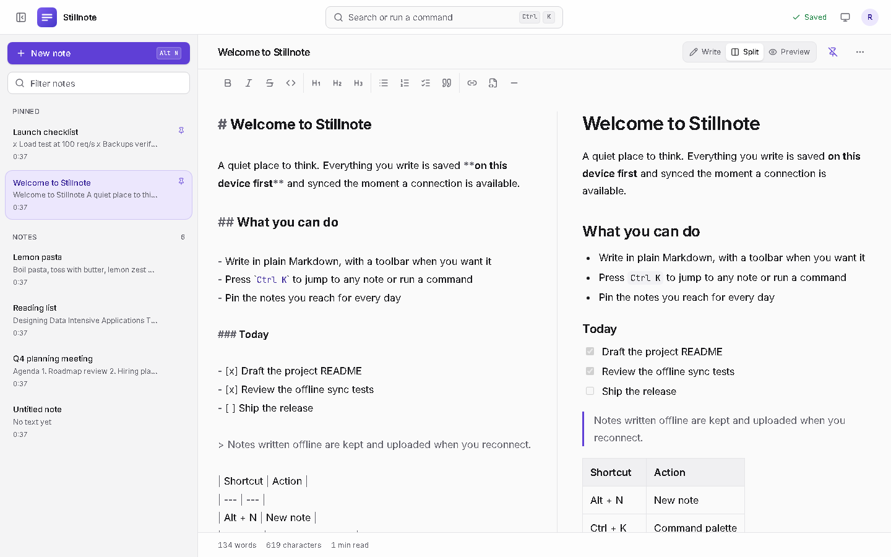
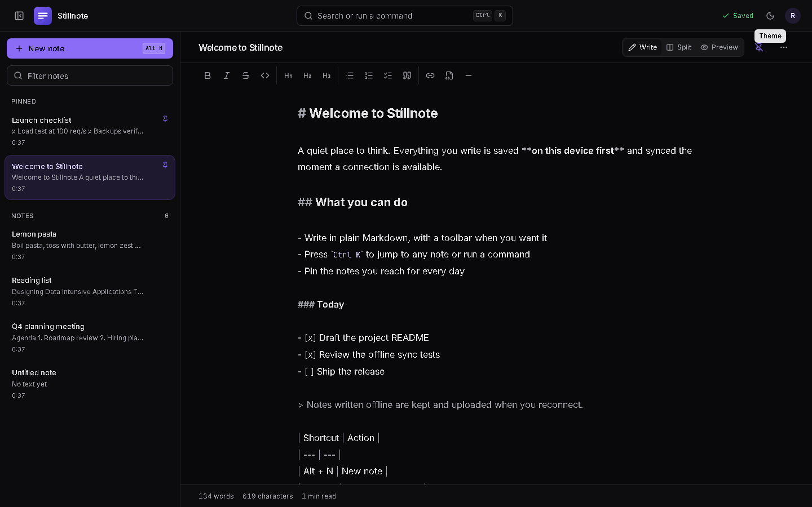
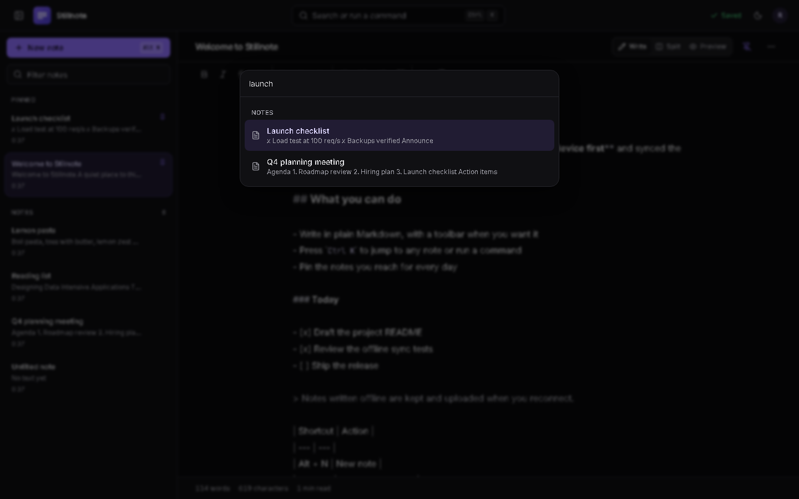
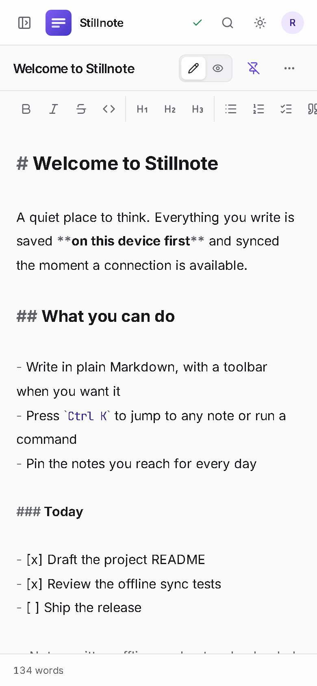

<div align="center">

# 📝 Stillnote

**A quiet, Markdown-first notes app that saves on your device first, syncs when it can, and never gets in your way.**

[](https://github.com/NYN-05/Stillnote/actions/workflows/ci.yml)
[](LICENSE)
[](#-known-limits)
[](https://nodejs.org)
[](https://www.typescriptlang.org)
[](https://react.dev)
[](https://fastify.dev)
[](https://www.postgresql.org)
[](#-key-features)

<br />



</div>

---

## 📖 Overview

Most note apps make you choose: fast and local, or synced and online. Stillnote does both. Every keystroke is written to your browser's database immediately, so the editor never waits on a network. A background sync engine uploads changes to the server, reconciles with your other devices, and quietly catches up after you have been offline.

### The problems it solves

| Problem                                                            | How Stillnote handles it                                                                                              |
| ------------------------------------------------------------------ | --------------------------------------------------------------------------------------------------------------------- |
| Notes apps that stall or lose text when the connection drops       | Edits are saved locally first and uploaded later; offline work is kept and synced on reconnect                        |
| Silent overwrites when two devices edit the same note              | Every write carries a version. A stale write is rejected, the newer edit wins by timestamp, and you are told          |
| Slow startup as your library grows                                 | The note list loads without note text; each note is fetched only when opened, so ten notes and ten thousand cost the same |
| Cluttered editors                                                  | A calm Markdown editor with an optional toolbar, split preview, light and dark themes, and a keyboard-first palette   |
| Self-hosting that is a weekend project                             | One `docker compose` file gives you nginx, API replicas, PostgreSQL and Redis, with backups, metrics and CI included  |

---

## ✨ Key Features

**Writing**

- ✍️ **Markdown editor** built on CodeMirror 6 with a formatting toolbar and shortcuts (bold, italic, headings, lists, task lists, quotes, links, code)
- 👀 **Write, Split and Preview modes**, with GitHub-flavoured Markdown (tables, task lists, strikethrough)
- 🔒 **Safe rendering:** raw HTML and `javascript:` links in a note are never executed (covered by an automated test)
- 🔤 Optional monospace font, word count, character count and reading time

**Library**

- ⌨️ **Command palette** (`Ctrl/⌘ + K`) to jump to any note or run any action
- 📌 **Pinning**, instant filtering, and a URL for every note (`/notes/:id`)
- 📤 Export a note as `.md` or `.txt`, or your whole library as JSON

**Offline-first sync**

- 💾 Full offline copy in IndexedDB, **one database per account**
- 🔁 Ordered uploads, conflict detection by version, deletes that cannot be resurrected by a late save
- 🌐 Works as an **installable PWA**; the service worker caches only the app shell, never your data

**Accounts and security**

- 👤 Email and password accounts, argon2id hashing, hashed server-side sessions in an `HttpOnly` cookie
- 🧱 Every query is scoped to the signed-in user; another user's note is indistinguishable from a missing one
- 🛡️ Strict Content-Security-Policy, per-account and per-IP rate limits, origin checks

**Operations**

- 📊 Prometheus metrics, JSON logs with request IDs, liveness and readiness endpoints, optional Sentry
- 🐳 Production Docker images, backup and restore scripts, GitHub Actions CI with browser and load-test gates

<div align="center">

|                                                  Dark theme                                                   |                                              Command palette                                              |                                       Mobile                                       |
| :-----------------------------------------------------------------------------------------------------------: | :-------------------------------------------------------------------------------------------------------: | :--------------------------------------------------------------------------------: |
|  |  |  |

</div>

---

## 🧰 Tech Stack & Architecture

| Layer          | Technology                                                                                                                 |
| -------------- | -------------------------------------------------------------------------------------------------------------------------- |
| **Frontend**   | React 18, TypeScript (strict), Vite 6, Tailwind CSS 4, Radix UI primitives, CodeMirror 6, React Router 7                   |
| **Client state** | TanStack Query (session), Zustand (UI preferences), a framework-free sync engine with IndexedDB via `idb`               |
| **Backend**    | Node.js 22, Fastify 5, pino logging, argon2, `@fastify/rate-limit`, `@fastify/helmet`, `@fastify/compress`                 |
| **Data**       | PostgreSQL 16 (notes, users, sessions) with numbered SQL migrations; Redis 7 (optional, shared rate-limit counters)        |
| **Delivery**   | Docker, nginx (static files, `/api` proxy, CSP, caching), PWA service worker                                               |
| **Quality**    | ESLint 9, Prettier, Husky + lint-staged, `node --test` (API), Vitest (sync engine), Playwright + axe (browser), k6 (load) |
| **Operations** | Prometheus metrics (`prom-client`), optional Sentry, `pg_dump` backup and restore scripts, GitHub Actions, Dependabot      |

### System overview

```text
                         ┌───────────────────────────── Browser ─────────────────────────────┐
                         │  React UI  ──►  Sync engine  ──►  IndexedDB (offline copy)        │
                         └───────────────────────────────┬───────────────────────────────────┘
                                                         │  HTTPS, cookie session
                                                  ┌──────▼──────┐
                                                  │    nginx    │  static app · /api proxy · CSP
                                                  └──────┬──────┘  (keep-alive pool, /metrics hidden)
                                      ┌──────────────────┼──────────────────┐
                               ┌──────▼──────┐    ┌──────▼──────┐    ┌──────▼──────┐
                               │ API replica │    │ API replica │    │ API replica │  Fastify, stateless
                               └──────┬──────┘    └──────┬──────┘    └──────┬──────┘
                                      └───────────┬──────┴────────┬─────────┘
                                           ┌──────▼──────┐  ┌─────▼─────┐
                                           │ PostgreSQL  │  │   Redis   │  rate-limit counters
                                           └─────────────┘  └───────────┘
```

### How a save travels

```text
 keystroke ─► apply in memory ─► write to IndexedDB (immediate, batched) ─► debounce 650 ms
                                                                              │
        ┌─────────────────────────── never seen by server? ───────────────────┤
        ▼ yes                                                                  ▼ no
   POST /api/documents                              PUT /api/documents/:id  { version }
        │                                                         │
        └───────────► server returns new version ◄────────────────┤
                                                                  ├─ 409 VERSION_CONFLICT ─► newer edit wins by timestamp,
                                                                  │                          you get a notice
                                                                  └─ network error ─► status "Offline", retry on reconnect
```

**Design decisions worth knowing**

- **The sync engine is plain TypeScript, not a React hook** (`client/src/lib/engine.ts`). That is what makes the hardest logic, ordering, conflicts and tombstones, unit-testable without a browser.
- **TanStack Query handles the session, not the notes.** A local-first store does not fit a request-cache model, so notes deliberately live in the engine.
- **Note text is lazy.** The list API returns summaries; `GET /api/documents/:id` returns the text. CodeMirror and the Markdown renderer are also loaded on demand.
- **The API is stateless.** Sessions live in PostgreSQL, so you can run as many replicas as you like behind nginx.

---

## 🗂️ Project Structure

```text
stillnote/
├── client/                         React app (Vite + TypeScript)
│   ├── src/
│   │   ├── lib/
│   │   │   ├── engine.ts           Offline-first sync engine (+ engine.test.ts)
│   │   │   ├── db.ts               IndexedDB store, one database per account
│   │   │   ├── merge.ts            Server/local merge rules
│   │   │   ├── api.ts              Typed API client
│   │   │   └── format.ts           Markdown formatting commands for the editor
│   │   ├── components/             Editor, sidebar, command palette, app shell
│   │   │   └── ui/                 Accessible primitives (button, dialog, menu, tooltip)
│   │   ├── hooks/                  Session (TanStack Query) and engine provider
│   │   └── routes/                 Sign-in, notes, settings
│   ├── nginx/                      Production web server config (CSP, caching, proxy)
│   ├── public/                     Icons, PWA assets, theme-init.js
│   └── Dockerfile
├── server/                         Fastify API
│   ├── src/
│   │   ├── app.js                  Routes, plugins, error handling
│   │   ├── auth.js                 Accounts and sessions
│   │   ├── documentStore.js        PostgreSQL note store (versions, pagination)
│   │   ├── metrics.js              Prometheus metrics
│   │   ├── db.js · config.js       Pool, migration runner, environment config
│   ├── migrations/                 Numbered SQL files applied at startup
│   ├── scripts/                    Legacy import and claim tools
│   ├── test/                       API tests against real PostgreSQL
│   ├── server.js · cluster.js      Single-process and one-worker-per-CPU entry points
│   └── Dockerfile
├── e2e/                            Playwright browser suite (CSP + accessibility checks)
├── loadtest/                       k6 workload, SQL seed data, rate-sweep runner
├── ops/                            backup.sh and restore.sh
├── scripts/verify.mjs              Runs the same checks as CI, in order
├── docs/screenshots/               Images used in this README
├── docker-compose.yml              Local PostgreSQL and Redis for development
├── docker-compose.prod.yml         Full production stack
├── .github/                        CI workflow and Dependabot
└── .env.example                    Every setting, documented
```

---

## 🚀 Getting Started

### Prerequisites

| Tool                                              | Version                            | Needed for                                  |
| ------------------------------------------------- | ---------------------------------- | ------------------------------------------- |
| [Node.js](https://nodejs.org)                     | 20 or later (22 recommended)       | Everything                                  |
| npm                                               | 9 or later (ships with Node)       | Everything                                  |
| [Git](https://git-scm.com)                        | Any recent version                 | Cloning                                     |
| [Docker](https://www.docker.com/products/docker-desktop/) | Docker Engine 24+ with Compose v2 | Local PostgreSQL and Redis, production stack |
| [k6](https://k6.io/docs/get-started/installation/) | Any recent version (optional)      | Load tests only                             |

### Installation and local setup

```bash
# 1. Clone and install (client and server are npm workspaces, one install covers both)
git clone https://github.com/NYN-05/Stillnote.git
cd Stillnote
npm install

# 2. Create your local configuration (defaults work as-is for development)
cp .env.example .env            # Windows PowerShell: Copy-Item .env.example .env

# 3. Start PostgreSQL and Redis in Docker
npm run db:up
```

The defaults in `.env.example` match `docker-compose.yml`, so no edits are required. The API creates the database tables itself on first start.

---

## ▶️ Running the Application

### Development (API and web together)

```bash
npm run dev
```

| Service          | URL                    |
| ---------------- | ---------------------- |
| Web app          | http://localhost:5173  |
| API              | http://localhost:4000  |
| API health check | http://localhost:4000/api/health/ready |

Open the web app and **create an account**. Vite proxies `/api` to the API, so there is no CORS setup to do.

### Running the two services separately

```bash
npm run dev:server    # terminal 1: API with auto-reload
npm run dev:client    # terminal 2: Vite dev server
```

### Useful commands

| Command                                              | What it does                                                    |
| ---------------------------------------------------- | --------------------------------------------------------------- |
| `npm run verify`                                     | Lint, formatting, types, API tests, client tests and build, the same as CI |
| `npm test` / `npm run test:client`                   | API tests (needs `npm run db:up`) / sync-engine tests           |
| `npm run e2e`                                        | Browser tests against a running stack (set `E2E_BASE_URL`)      |
| `npm run lint` · `format` · `typecheck`              | ESLint, Prettier, TypeScript                                    |
| `npm run db:down`                                    | Stop local PostgreSQL and Redis                                 |
| `npm run db:claim -- you@example.com`                | Assign notes created before accounts existed to an account      |
| `npm start` · `npm run start:cluster`                | One API process · one worker per CPU (production)               |

### 🐳 Production with Docker

```bash
cp .env.production.example .env.production   # set POSTGRES_PASSWORD and PUBLIC_ORIGIN
docker compose -f docker-compose.prod.yml --env-file .env.production up -d --build
docker compose -f docker-compose.prod.yml --env-file .env.production up -d --scale api=3   # more API replicas
```

nginx serves the app and proxies `/api` on one origin (default `http://localhost:8080`). Put a TLS-terminating proxy or load balancer in front of it for public use, and set `ALLOW_REGISTRATION=false` once your accounts exist.

<details>
<summary><strong>Configuration reference</strong></summary>

<br />

| Variable                                       | Default                      | Purpose                                                            |
| ---------------------------------------------- | ---------------------------- | ------------------------------------------------------------------ |
| `DATABASE_URL`                                 | local compose database       | PostgreSQL connection string                                       |
| `PG_POOL_MAX`                                  | `20`                         | Connections per API process                                        |
| `REDIS_URL`                                    | empty                        | Share rate limits across processes; empty keeps counters in memory |
| `CLIENT_ORIGINS`                               | `localhost:5173`, `:4173`    | Origins allowed to call the API                                    |
| `TRUST_PROXY`                                  | `false`                      | Set `true` behind nginx or a load balancer so client IPs are real  |
| `COOKIE_SECURE`                                | `true` in production         | Send the session cookie only over HTTPS                            |
| `ALLOW_REGISTRATION`                           | `true`                       | Set `false` to close sign-up                                       |
| `SESSION_TTL_DAYS`                             | `30`                         | Session lifetime                                                   |
| `RATE_LIMIT_MAX`, `RATE_LIMIT_WINDOW_SECONDS`  | `1200`, `60`                 | Requests per window per signed-in user (per IP when signed out)    |
| `AUTH_RATE_LIMIT_MAX`                          | `10`                         | Sign-in and sign-up attempts per minute per IP                     |
| `METRICS_ENABLED`, `METRICS_TOKEN`             | `true`, empty                | `GET /metrics`, with an optional bearer token                      |
| `SENTRY_DSN`                                   | empty                        | Enables error reporting when set                                   |
| `LOG_LEVEL`, `WEB_CONCURRENCY`, `PORT`, `HOST` | `info`, CPU count, `4000`    | Logging, cluster size, listen address                              |

</details>

### 🔧 Operations

- **Backups:** `ops/backup.sh` writes a verified, compressed dump and keeps the newest 14. `ops/restore.sh <dump>` restores it, stopping the API while it runs. A full data-loss drill (delete, restore, verify) has been run end to end.
  ```bash
  ENV_FILE=.env.production ops/backup.sh /var/backups/stillnote
  ENV_FILE=.env.production ops/restore.sh /var/backups/stillnote/stillnote-<timestamp>.dump
  ```
- **Metrics:** `GET /metrics` on each API container (internal network only; nginx never exposes it): latency histograms by route template, database pool gauges, process metrics.
- **Health:** `/api/health/live` for liveness; `/api/health/ready` checks the database and reports Redis.
- **Logs:** JSON (pino) with an `x-request-id` on every response; cookies are redacted.

---

## ✅ Testing and Quality

| Layer               | Tool          | Count | What it proves                                                                                                                                                  |
| ------------------- | ------------- | ----: | --------------------------------------------------------------------------------------------------------------------------------------------------------------- |
| API and data        | `node --test` |    18 | Per-user isolation, version conflicts under concurrent writers, pagination, sessions, rate limits, origin guard, metrics, error capture, on real PostgreSQL     |
| Sync engine         | Vitest        |    22 | Offline start, ordered saves, conflicts both ways, tombstones, 404 and 409 recovery, merge rules, deep links to notes not yet on the device                     |
| Browser, full stack | Playwright    |    11 | Sign-up and sign-in, formatting, split preview, reload persistence, offline edits syncing back, account isolation, script-injection safety, zero console or CSP violations, accessibility scans (axe) in light and dark |

CI (`.github/workflows/ci.yml`) runs lint, formatting, type checks, API and client tests and the build; then brings up the production Docker stack (nginx, two API replicas, PostgreSQL, Redis) and runs the browser suite plus a load-test gate against it; then publishes images to GitHub Container Registry from `main` and version tags.

Testing against the nginx stack, not just the dev server, is deliberate. It has already caught a Content-Security-Policy violation and a proxy connection-exhaustion bug that dev mode hides.

---

## ⚡ Performance

Measured with [k6](https://k6.io) on one Windows machine (16 threads) where the load generator, Docker Desktop, nginx, the API and PostgreSQL all share the same CPUs, so these numbers are a floor. The data set is 500 accounts and 10,000 notes of about 3 KB each, driven at a fixed request rate with a realistic mix: **70% saves, 20% opening a note, 10% loading the list**.

| Setup                 | Request rate | p50    | p95      | p99      | Errors             |
| --------------------- | -----------: | ------ | -------- | -------- | ------------------ |
| 1 API replica         |      100 / s | 5 ms   | 8 ms     | 11 ms    | 0%                 |
| 1 API replica         |    1,000 / s | 3 ms   | 9 ms     | 18 ms    | 0%                 |
| 1 API replica         |    1,600 / s | 6 ms   | 25 ms    | 60 ms    | 0%                 |
| 1 API replica         |    2,000 / s | 879 ms | 1,448 ms | 2,824 ms | saturated (1,764/s)|
| 2 replicas, 3 minutes |      300 / s | 4 ms   | 11 ms    | 14 ms    | 0%, memory flat    |

A single API process comfortably sustains **16× a 100 requests-per-second target** within a 150 ms p95 goal. A person typing sends roughly one save per second, so 1,600 requests per second is on the order of a thousand people writing at the same moment.

Reproduce it yourself:

```bash
export COMPOSE_FILE=docker-compose.prod.yml ENV_FILE=.env.production
npm run loadtest:seed
npm run loadtest -- --rates 100,300,600,1000 --duration 60s --base-url http://localhost:8080
```

---

## 🔌 API Reference and Core Usage

All endpoints speak JSON. Sign-in sets an `HttpOnly` session cookie; every `/api/documents` route needs it and only ever sees the signed-in user's notes.

| Method   | Endpoint                          | Description                                                                                                          |
| -------- | --------------------------------- | -------------------------------------------------------------------------------------------------------------------- |
| `POST`   | `/api/auth/register`              | Create an account (`email`, `password` of 10 to 128 characters) and sign in                                          |
| `POST`   | `/api/auth/login`                 | Sign in                                                                                                              |
| `POST`   | `/api/auth/logout`                | End the session                                                                                                      |
| `GET`    | `/api/auth/me`                    | The signed-in user, or `401`                                                                                         |
| `GET`    | `/api/documents?limit=&cursor=`   | Note summaries without text (`id`, `title`, `snippet`, `pinned`, `version`, timestamps), newest first, cursor-paged |
| `GET`    | `/api/documents/:id`              | One note with its full text                                                                                          |
| `POST`   | `/api/documents`                  | Create a note (optional `id`, `title`, `content`, `pinned`)                                                          |
| `PUT`    | `/api/documents/:id`              | Update `title`, `content` and/or `pinned`; include `version` to make it conditional                                  |
| `DELETE` | `/api/documents/:id`              | Delete a note (soft delete)                                                                                          |
| `GET`    | `/api/health/live` · `/ready`     | Liveness · readiness (database and Redis)                                                                            |
| `GET`    | `/metrics`                        | Prometheus metrics (internal network; optional bearer token)                                                         |

Limits: titles up to 120 characters, note text up to 500,000.

**Try it from the terminal**

```bash
# Create an account (the cookie is saved in jar.txt)
curl -c jar.txt -X POST http://localhost:4000/api/auth/register \
  -H 'Content-Type: application/json' \
  -d '{"email":"you@example.com","password":"a-long-password"}'

# Create a note, then list your notes
curl -b jar.txt -X POST http://localhost:4000/api/documents \
  -H 'Content-Type: application/json' \
  -d '{"title":"Hello","content":"# Hi from curl"}'
curl -b jar.txt http://localhost:4000/api/documents
```

**Conflicts are explicit.** Saving with an out-of-date `version` returns the current note so the client can decide:

```json
{
  "error": {
    "code": "VERSION_CONFLICT",
    "message": "The document was changed by another session.",
    "details": { "current": { "id": "…", "title": "Hello", "content": "…", "version": 4 } }
  }
}
```

**Keyboard shortcuts**

| Shortcut                  | Action                  |
| ------------------------- | ----------------------- |
| `Ctrl/⌘ + K`              | Command palette         |
| `Alt + N`                 | New note                |
| `Ctrl/⌘ + S`              | Save now                |
| `Ctrl/⌘ + B` · `Ctrl/⌘ + I` | Bold · italic         |
| `Ctrl/⌘ + \`              | Show or hide the sidebar |

---

## 🔐 Security Notes

- **Passwords** are hashed with argon2id. **Sessions** are random 256-bit tokens; only their SHA-256 is stored, and logout revokes them. Unknown emails cost the same time as wrong passwords.
- **Cookies** are `HttpOnly` and `SameSite=Lax`, and `Secure` in production. Unsafe requests from origins outside `CLIENT_ORIGINS` are rejected.
- **Content:** Markdown never renders raw HTML, unsafe URL schemes are stripped, and nginx sends a strict `script-src 'self'` policy.
- **Abuse:** sign-in is rate-limited per IP; everything else per account.
- Run behind HTTPS. Sign-up is open by default, and "email already exists" reveals registered emails, so set `ALLOW_REGISTRATION=false` once you have your accounts.

## 🚧 Known Limits

- Conflict handling is "newer edit wins" using the editing device's clock. It is not a merge: two devices editing the **same note at the same moment** keep one version, and you are notified.
- Notes you have never opened on a device cannot be read offline there, and search inside them covers only their first 200 characters until opened.
- Not built yet: password reset, email verification, folders and tags.
- Signing out keeps this device's offline copy. Clear the site's data on a shared computer.

## 🤝 Contributing

1. Fork the repository and create a branch.
2. Run `npm run verify` before you push; it runs exactly what CI runs.
3. A pre-commit hook (ESLint and Prettier on staged files) installs with `npm install`.
4. Use [Conventional Commits](https://www.conventionalcommits.org) (`feat:`, `fix:`, `docs:`, `test:`, `perf:`, `ci:`, `chore:`) and open a pull request.

---

## 📄 License

Released under the **MIT License**. See [LICENSE](LICENSE) for the full text.

## 🙏 Acknowledgments

Stillnote stands on excellent open-source work:

- [React](https://react.dev), [Vite](https://vitejs.dev), [Tailwind CSS](https://tailwindcss.com) and [TypeScript](https://www.typescriptlang.org) for the app
- [CodeMirror](https://codemirror.net) for the editor, [react-markdown](https://github.com/remarkjs/react-markdown) and [remark-gfm](https://github.com/remarkjs/remark-gfm) for rendering
- [Radix UI](https://www.radix-ui.com), [cmdk](https://cmdk.paco.me), [sonner](https://sonner.emilkowal.ski) and [Lucide](https://lucide.dev) for accessible interface pieces
- [TanStack Query](https://tanstack.com/query), [Zustand](https://zustand-demo.pmnd.rs), [React Router](https://reactrouter.com) and [idb](https://github.com/jakearchibald/idb) for state, routing and storage
- [Fastify](https://fastify.dev), [PostgreSQL](https://www.postgresql.org), [Redis](https://redis.io) and [argon2](https://github.com/ranisalt/node-argon2) for the backend
- [Playwright](https://playwright.dev), [axe-core](https://github.com/dequelabs/axe-core), [Vitest](https://vitest.dev) and [k6](https://k6.io) for testing and load testing

<div align="center">

Made with care by [NYN-05](https://github.com/NYN-05) · [Report an issue](https://github.com/NYN-05/Stillnote/issues)

</div>
