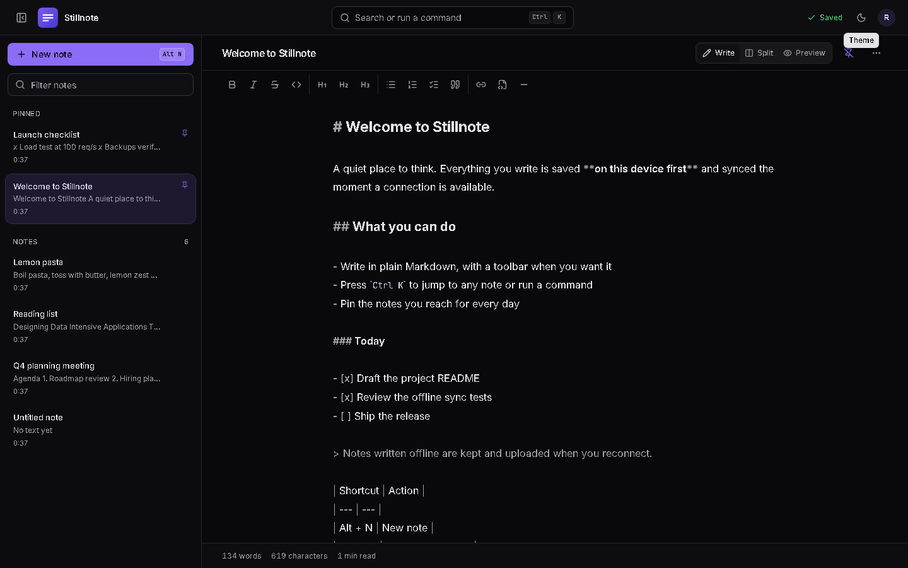

<div align="center">
  
  <h1>Stillnote</h1>
  <p><strong>A quieter place to think.</strong></p>
  <p>Offline-first notes with a calm editor, reliable sync, and zero distractions.</p>

<br />

> **Stillnote** is a private, focused workspace for writing notes. It saves locally first, keeps working offline, and syncs with the server when a connection is available.

<div align="center">
  
</div>

## ✨ Why Stillnote?

- **⚡ Offline-first** — keep writing when the network disappears; local changes are reconciled when you reconnect.
- **📝 Rich-text editor** — headings, lists, checklists, links, tables, images, alignment, Markdown, and more.
- **🔎 Quick navigation** — filter notes or open the command palette with <kbd>Ctrl</kbd>/<kbd>⌘</kbd> + <kbd>K</kbd>.
- **📌 Pin what matters** — keep frequently used notes at the top of your sidebar.
- **🌗 Comfortable themes** — light, dark, and system theme modes.
- **🔐 Account-backed sync** — secure session cookies, Argon2 password hashing, rate limiting, and protected API routes.
- **📦 Portable data** — export all notes as a readable JSON file from Settings.
- **📱 Responsive by default** — a focused editor experience on desktop and mobile.

## 🧰 Tech stack

| Layer        | Technology                                                             |
| ------------ | ---------------------------------------------------------------------- |
| Client       | React 18, TypeScript, Vite, React Router                               |
| Editor       | Tiptap, Markdown support, DOMPurify                                    |
| State & data | Zustand, TanStack Query, IndexedDB                                     |
| API          | Fastify 5, Node.js 20+                                                 |
| Persistence  | PostgreSQL 16, Redis 7 (optional rate-limit store)                     |
| Quality      | ESLint, Prettier, Vitest, Node test runner, Playwright                 |
| Operations   | Docker Compose, Helmet, compression, health checks, Prometheus metrics |

## 🚀 Quick start

### Prerequisites

- [Node.js 20+](https://nodejs.org/)
- npm 9+
- [Docker Desktop](https://www.docker.com/products/docker-desktop/) for PostgreSQL and Redis

### 1. Install

```bash
git clone https://github.com/NYN-05/Stillnote.git
cd Stillnote
npm install
```

### 2. Configure the API

Create a root `.env` file from the example:

```bash
cp .env.example .env
```

On Windows PowerShell, use:

```powershell
Copy-Item .env.example .env
```

The example is preconfigured for local development. Adjust `DATABASE_URL`, `CLIENT_ORIGINS`, or authentication settings when needed.

### 3. Start dependencies and migrate

```bash
npm run db:up
npm run db:migrate
```

### 4. Start Stillnote

```bash
npm run dev
```

Open **[http://localhost:5173](http://localhost:5173)** in your browser. The API runs at **[http://localhost:4000](http://localhost:4000)**.

## 🐳 Docker

Stillnote includes Docker Compose configurations for local development dependencies and a complete production-style deployment.

### Local development with Docker

Use Docker for PostgreSQL and Redis, while running the client and API with the local development workflow:

```bash
# Start PostgreSQL and Redis
npm run db:up

# Apply migrations
npm run db:migrate

# Start Vite and Fastify
npm run dev
```

The local services are available at:

| Service          | Address                                       |
| ---------------- | --------------------------------------------- |
| Stillnote client | [http://localhost:5173](http://localhost:5173) |
| Fastify API      | [http://localhost:4000](http://localhost:4000) |
| PostgreSQL       | `localhost:5432`                            |
| Redis            | `localhost:6379`                            |

For local troubleshooting, `CLIENT_ORIGINS=*` is supported and reflects the requesting origin for cookie-based requests. Do not use this setting in production; keep an explicit origin allowlist in `.env.production`.

Stop the local containers when finished:

```bash
npm run db:down
```

You can also use Docker Compose directly:

```bash
docker compose up -d --wait postgres redis
docker compose down
```

### Production-style deployment with Docker

The production Compose file runs the complete stack:

```text
nginx/web → Fastify API → PostgreSQL
                   └──→ Redis
```

1. Copy the production environment template:

   ```bash
   cp .env.production.example .env.production
   ```

   On Windows PowerShell:

   ```powershell
   Copy-Item .env.production.example .env.production
   ```
2. Edit `.env.production` and set at least:

   ```dotenv
   POSTGRES_PASSWORD=use-a-long-random-password
   PUBLIC_ORIGIN=https://notes.example.com
   WEB_PORT=8080
   ```
3. Build and start the production stack:

   ```bash
   docker compose -f docker-compose.prod.yml --env-file .env.production up -d --build
   ```
4. Open `http://localhost:8080`, or place a TLS-terminating reverse proxy/load balancer in front of that port.

The API container applies database migrations on startup. Only the web container publishes a host port; PostgreSQL, Redis, and the API remain on the internal Compose network.

Useful production commands:

```bash
# Follow application logs
docker compose -f docker-compose.prod.yml --env-file .env.production logs -f web api

# Check container health
docker compose -f docker-compose.prod.yml --env-file .env.production ps

# Scale the API workers
docker compose -f docker-compose.prod.yml --env-file .env.production up -d --scale api=3

# Stop the stack without deleting the database volume
docker compose -f docker-compose.prod.yml --env-file .env.production down
```

> **Production checklist:** use a strong `POSTGRES_PASSWORD`, set `PUBLIC_ORIGIN` to the exact public URL, keep `.env.production` out of version control, terminate HTTPS at your proxy/load balancer, and create database backups before upgrades.

## 📜 Commands

| Command                  | Description                                    |
| ------------------------ | ---------------------------------------------- |
| `npm run dev`          | Start the client and API together              |
| `npm run dev:client`   | Start only the Vite client                     |
| `npm run dev:server`   | Start only the Fastify API                     |
| `npm run build`        | Create a production client build               |
| `npm start`            | Start the API in production mode               |
| `npm run db:up`        | Start PostgreSQL and Redis with Docker Compose |
| `npm run db:down`      | Stop local infrastructure                      |
| `npm run db:migrate`   | Apply database migrations                      |
| `npm test`             | Run server tests                               |
| `npm run test:client`  | Run client unit tests                          |
| `npm run e2e`          | Run Playwright end-to-end tests                |
| `npm run typecheck`    | Type-check the client                          |
| `npm run lint`         | Run ESLint                                     |
| `npm run format:check` | Verify Prettier formatting                     |
| `npm run verify`       | Run the repository verification checks         |

## 🗂️ Project structure

```text
stillnote/
├── client/                 # React + Vite web application
│   ├── public/             # PWA assets, favicon, theme bootstrap
│   └── src/
│       ├── components/     # Editor, shell, command palette, UI primitives
│       ├── hooks/          # Session and offline-sync engine
│       ├── lib/            # API, IndexedDB, models, editor utilities
│       └── routes/         # Login, notes, and settings screens
├── server/                 # Fastify API and persistence layer
│   ├── migrations/         # PostgreSQL schema migrations
│   ├── src/                # Auth, database, content, metrics, and routes
│   └── test/               # Server unit tests
├── e2e/                    # Playwright browser tests
├── docs/screenshots/       # Product screenshots
├── docker-compose.yml      # Local PostgreSQL and Redis services
└── package.json            # Workspace scripts and shared tooling
```

### How sync works

1. Edits are written to the browser's local IndexedDB store first.
2. The UI remains usable while offline and exposes sync state in the app shell.
3. When connectivity returns, the sync engine reconciles local changes with the Fastify API.
4. The API persists note content in PostgreSQL and uses the authenticated session to scope data.

## 🔌 API health endpoints

Use these endpoints to verify a local or deployed API:

```text
GET /api/health/live   # process liveness
GET /api/health/ready  # database readiness
GET /api/health        # readiness alias
```

If metrics are enabled, Prometheus data is available at `GET /metrics`.

## 🧪 Testing before opening a PR

Run the focused checks first:

```bash
npm run typecheck
npm run test:client
npm test
npm run lint
npm run build
```

For browser-level changes, also run:

```bash
npm run e2e
```

## 🤝 Contributing

1. Create a focused branch from `main`.
2. Keep changes small and explain user-visible behavior in the pull request.
3. Add or update tests for behavior you change.
4. Run the relevant checks from the table above.
5. Open a pull request with screenshots for UI changes.

Please avoid committing `.env` files, database dumps, or generated build output.

## 📄 License

See the repository license file for usage and distribution terms.

<div align="center">
  <br />
  <sub>Built for thoughtful writing, one note at a time.</sub>
</div>
